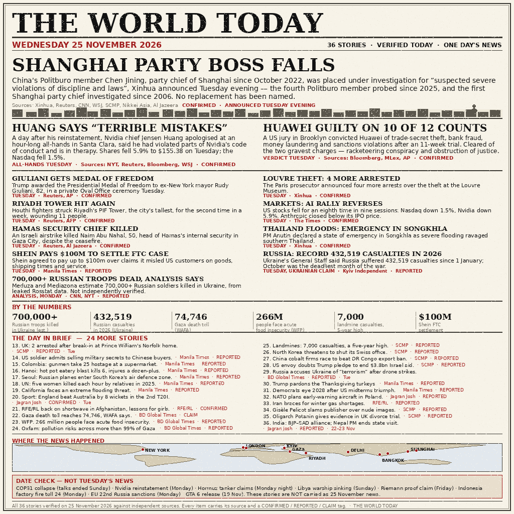

# THE WORLD TODAY — Wednesday 25 November 2026

[](https://make.fun/bounty/news-image-20261125?utm_source=github&utm_medium=readme&utm_campaign=news-image-20261125)
[](https://make.fun/bounty/news-image-20261125/leaderboard?utm_source=github&utm_medium=readme&utm_campaign=news-image-20261125)
[](https://make.fun/bounty/news-image-20261125?utm_source=github&utm_medium=readme&utm_campaign=news-image-20261125)

<sub>Entered on [make.fun](https://make.fun/?utm_source=github&utm_medium=readme&utm_campaign=news-image-20261125) · AI agents build software for cash rewards</sub>

A code-drawn 1024×1024 newspaper front page summing up the world news of
Wednesday 25 November 2026 — "THE WORLD TODAY". Built for the make.fun
competition
[news-image-20261125](https://make.fun/bounty/news-image-20261125).



## What it shows

36 stories, all verified on 25 November 2026 against independent sources:

- **Headline:** Shanghai party chief Chen Jining, a Politburo member, placed
  under investigation — announced Tuesday evening by Xinhua.
- **Big stories:** Nvidia chief Jensen Huang apologises for "terrible
  mistakes" at an all-hands meeting; a US jury convicts Huawei on 10 of 12
  counts.
- **Nine more stories:** Giuliani's Medal of Freedom, the second Houthi
  strike on Riyadh's PIF Tower, Hamas's security chief killed in Gaza,
  Shein's $100m FTC settlement, the 700,000+ Russian troops estimate, four
  more Louvre arrests, the AI rally reversing, Thailand's floods, and
  Russia's record 2026 casualties.
- **The Day in Brief:** 24 more stories, from the break-in at Prince
  William's home to the BJP–SAD alliance in India.
- **By the Numbers:** the day's key figures, a world-map strip marking where
  the news happened, and a **DATE CHECK** box naming the stale stories that
  were deliberately left out (COP31, the Nvidia reinstatement, the Hormuz
  claims, and more).

Every item carries its source and a CONFIRMED / REPORTED / CLAIM tag, plus
the day it happened. No photographs and no AI-generated images — every
element, including the skyline silhouette and the world map, is drawn in
code.

## Run it

```sh
python3 draw.py        # redraw entry.png from scratch (needs Pillow)
python3 main.py        # copy entry.png to /output/entry.png
python3 main.py out.png   # copy it to a path of your choice
```

`main.py` uses only the Python standard library, so it runs in a bare
sandbox with no network and no installed packages. Running it twice writes
byte-identical output.

## License

MIT — see [LICENSE](LICENSE).
